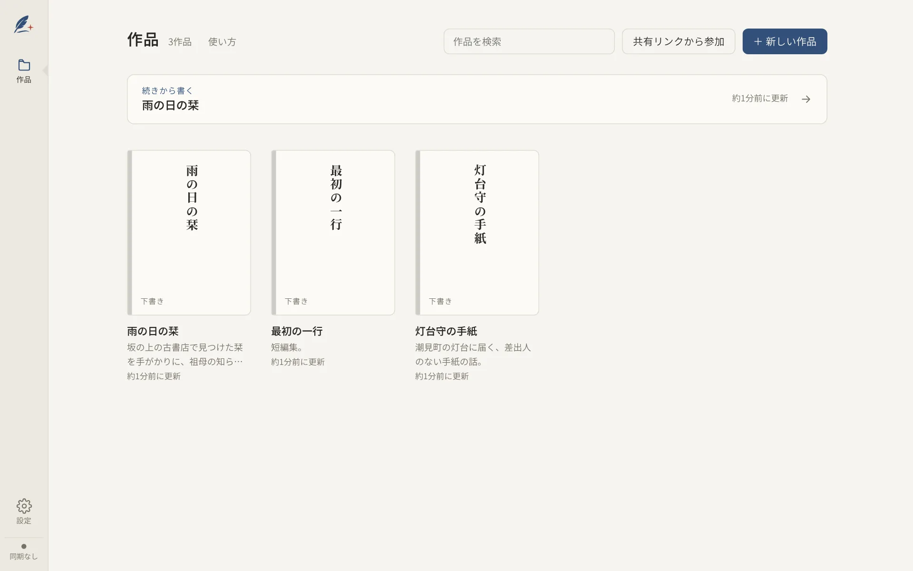
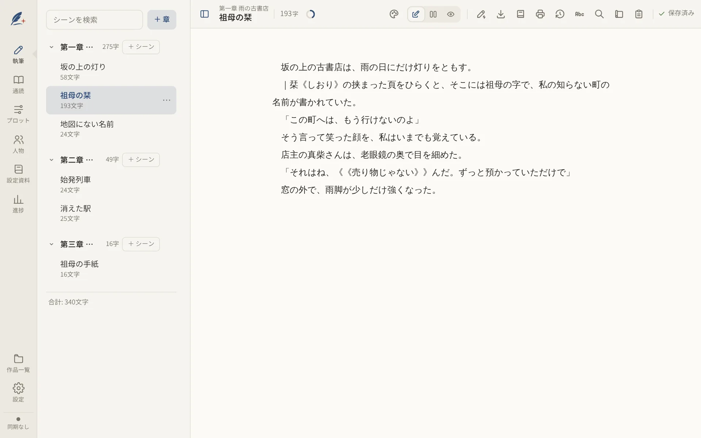
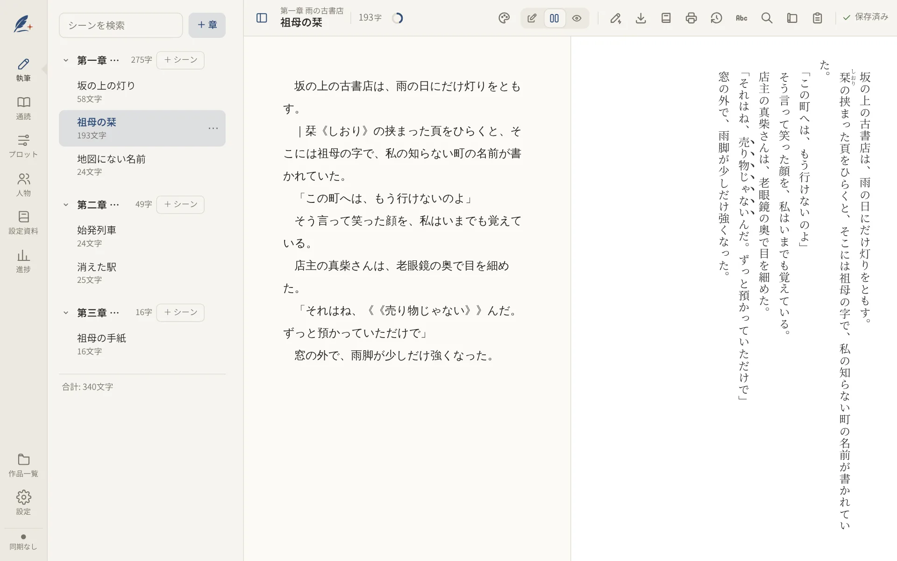
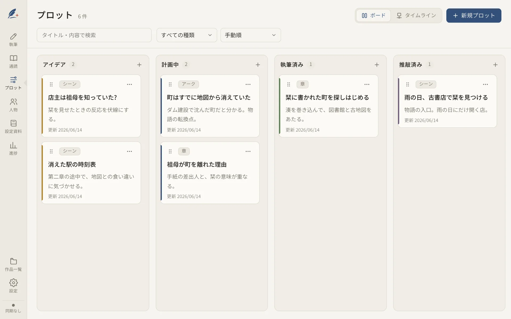
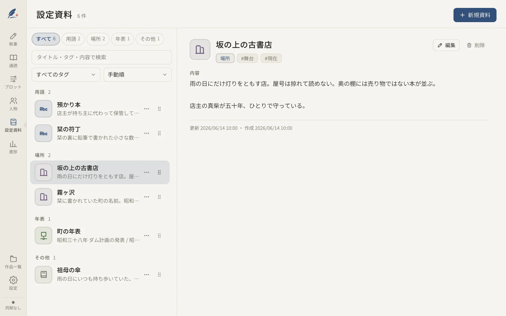
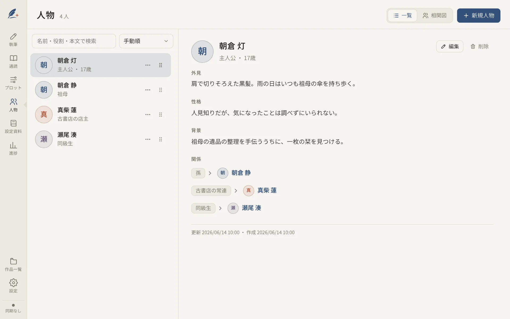
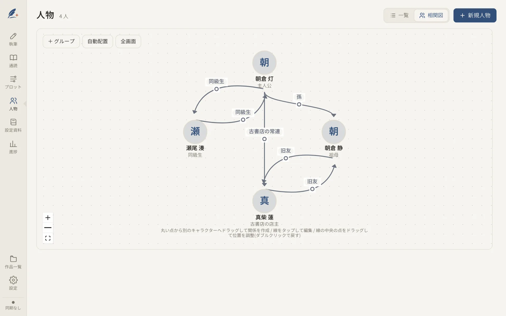
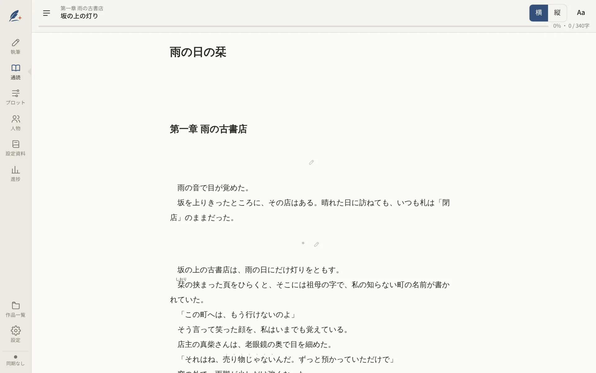
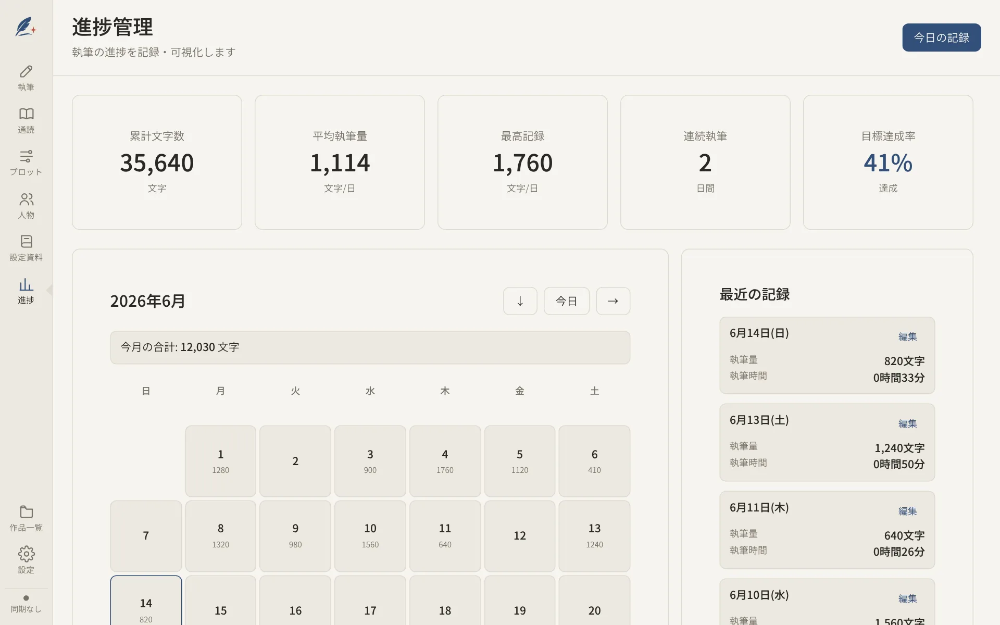

<p align="center">
  <picture>
    <source media="(prefers-color-scheme: dark)" srcset="static/brand/storift-logo-light.svg">
    
  </picture>
</p>

<h1 align="center">Storift</h1>

<p align="center">小説を書くための、ひとつの場所。</p>

<p align="center">
  <a href="https://github.com/shiki-01/Storift/releases"></a>
  <a href="LICENSE"></a>
  <a href="https://github.com/shiki-01/Storift/actions/workflows/deploy-app.yml"></a>
</p>

<p align="center">
  <a href="https://storift.shiki-01.com">公開サイト</a> /
  <a href="https://app.storift.shiki-01.com">Web 版を開く</a> /
  <a href="https://github.com/shiki-01/Storift/releases">デスクトップ版をダウンロード</a>
</p>

<p align="center">
  <picture>
    <source media="(prefers-color-scheme: dark)" srcset="docs/images/home-dark.webp">
    
  </picture>
</p>

Storift は、原稿・プロット・人物・設定資料・進捗を作品ごとにまとめて管理する、小説執筆アプリです。ブラウザで動き、一度開けばオフラインでも書けます。Windows・macOS・Linux 向けのデスクトップ版もあり、デスクトップ版では AI をサイドパネルから使えます。

> **English summary:** Storift is a novel-writing app that keeps manuscripts, plots, characters, world-building notes and progress together for each work. It runs in the browser as an offline-capable PWA, and a desktop version (Windows, macOS, Linux) is also available. Manuscripts are stored on your device, and optional sync and real-time collaboration use your own Firebase project, so the maintainer cannot see your content. The interface is in Japanese. MIT licensed.

## スクリーンショット

|                                                                                                                                                                                                                        |                                                                                                                                                                                                                        |
| ---------------------------------------------------------------------------------------------------------------------------------------------------------------------------------------------------------------------- | ---------------------------------------------------------------------------------------------------------------------------------------------------------------------------------------------------------------------- |
| <picture><source media="(prefers-color-scheme: dark)" srcset="docs/images/editor-dark.webp"></picture><br>執筆       | <picture><source media="(prefers-color-scheme: dark)" srcset="docs/images/split-dark.webp"></picture><br>二画面 |
| <picture><source media="(prefers-color-scheme: dark)" srcset="docs/images/plot-dark.webp"></picture><br>プロット | <picture><source media="(prefers-color-scheme: dark)" srcset="docs/images/world-dark.webp"></picture><br>設定資料                       |
| <picture><source media="(prefers-color-scheme: dark)" srcset="docs/images/characters-dark.webp"></picture><br>人物                     | <picture><source media="(prefers-color-scheme: dark)" srcset="docs/images/relation-dark.webp"></picture><br>相関図                       |
| <picture><source media="(prefers-color-scheme: dark)" srcset="docs/images/preview-dark.webp"></picture><br>通読     | <picture><source media="(prefers-color-scheme: dark)" srcset="docs/images/progress-dark.webp"></picture><br>進捗         |

## 主な機能

### 書く

- 作品を章とシーンに分けて執筆します。文字数の表示、ルビ・傍点の記法、書式設定、校正、検索と置換に対応しています。
- 自動保存は、入力が止まって約 2 秒後に行います。入力し続けているときの最大の待ち時間は設定で変えられます(既定は 30 秒)。
- 履歴を残し、以前の状態へ戻せます。
- 執筆画面の上部のツールバーは、ボタンの並べ替えと、三点メニュー(…)へのまとめができます(設定の「エディタ」。端末ごとの設定)。

### 整理する

- プロット、人物、設定資料を作品ごとに管理します。一覧と詳細の画面があり、詳細では全文を読めます。
- 人物同士の関係は相関図で整理できます。
- 一覧は、ドラッグ、キーボード操作、「上へ」「下へ」のボタンで並べ替えられます。
- 進捗の画面で、執筆量を記録し、目標に対する進み具合を確認できます。

### 確かめる

- 通読プレビューで、章をまたいで作品を最初から最後まで読めます(横書き・縦書き、目次ジャンプ)。
- 縦書きや原稿用紙のレイアウトで確認でき、印刷用のプレビューも開けます。

### 書き出す

- TXT / Markdown / DOCX / PDF / EPUB / JSON に書き出せます。シーン単位では、投稿サイト向けのルビ記法への変換にも対応しています。
- 外部の AI に添削を頼むために、章ごと・作品全体を Markdown でコピー/保存できます(「AI 添削用にコピー」)。作品の設定も添えられます。

### 拡張機能

- 設定の「拡張機能」で、追加の機能を一つずつ有効にできます(既定はすべて無効。有効/無効は端末ごと)。有効にした拡張機能は、ツールバーにアイコンが加わり、押すとポップアップで操作できます(スマホは「操作」シートから)。
- **Monolog. 連携**: 執筆している間の時間と増減した文字数を、時間記録アプリ [Monolog.](https://www.monolog.life) に記録します(Web 版は本番のエディタ、およびデスクトップ版)。Monolog. に接続したときだけ、開始・終了時刻、所要時間、タイトル、メモ(増減した文字数)、タグを送ります。**本文は送りません。**
- 仕組みと拡張の足し方は [docs/EXTENSIONS.md](docs/EXTENSIONS.md) を参照してください。

### AI 連携(デスクトップ版)

- Claude Code、OpenAI 互換 API、Anthropic API、Gemini、Ollama から選び、原稿を読ませて、校正・矛盾チェック・質問・書き換えを依頼できます。
- 本文の編集は「提案のみ」「差分を確認して反映」「自動で反映(後から確認)」から選べます。
- 詳細は [docs/DESKTOP.md](docs/DESKTOP.md) を参照してください。

## 共同編集と同期

複数端末での同期と、作品の共有・共同編集は、利用者自身の Firebase プロジェクトで行います。Storift が運営するサーバーに原稿を預ける仕組みではありません。

- 原稿は端末内(IndexedDB)に保存されます。Firebase の設定は任意で、設定した場合のみ、利用者自身の Firebase(Firestore)にも保存されます。
- データの保管先が利用者の端末と利用者自身の Firebase だけなので、運営者が原稿の内容を見ることはできません。
- 作品ごとに招待リンクを発行して共有できます(閲覧／編集の権限、パスワードは任意)。共有した作品の本文は、複数人で同時に編集できます。
- 招待リンクには**ホストの Firebase の設定**が入ります。ゲストが編集したデータはホストの Firebase に保存されます。リンクを知っている人は誰でも参加できるため、扱いに注意してください。
- 新しいセキュリティルール(`firestore.rules`)では、オーナー登録した端末だけが自分のデータにアクセスできます。2 台目以降は、1 台目の設定 →「共有」で表示した「設定コード」を貼り付けて登録します。設定コードを持つ人は全データにアクセスできるので、共有には使わないでください。
- 設定手順は [docs/FIRESTORE_SETUP.md](docs/FIRESTORE_SETUP.md)、ルールの仕様は [docs/SHARING_RULES.md](docs/SHARING_RULES.md) にあります。

## インストール

### Web 版(PWA)

<https://app.storift.shiki-01.com> を開くだけで使えます。インストールは不要です。ホーム画面やアプリ一覧に追加すると、アプリのように起動できます。一度開けば、通信なしでも起動します。詳細は [docs/PWA.md](docs/PWA.md) を参照してください。

### デスクトップ版

Windows・macOS・Linux 向けを [GitHub Releases](https://github.com/shiki-01/Storift/releases) で配布しています。

- 新しい版があるとアプリ内に通知が出ます。「更新」を押すとダウンロードして入れます。自動では入れません。
- macOS 版はアドホック署名のみ(Apple の署名・公証はなし)、Windows 版は署名なしのため、初回起動時に OS の警告が出ます。対処は [docs/DESKTOP.md](docs/DESKTOP.md) にあります。

## 始め方

1. エディタを開きます。初回に Firebase の設定を案内されますが、「設定せずに始める」で省略できます(あとから設定画面でも設定できます)。
2. 作品一覧の「新しい作品」から作品を作ります。
3. 章とシーンを作って書き始めます。内容は自動で保存されます。

詳しい手順は、公開サイトの[使い方](https://storift.shiki-01.com/guide)と [Q&A](https://storift.shiki-01.com/faq) にあります。変更点は [CHANGELOG.md](CHANGELOG.md) を参照してください。

## データとバックアップ

- 原稿はブラウザのデータ(IndexedDB)に保存されます。ブラウザのデータを消すと、端末内の作品も消えます。大事な作品は、ときどき書き出してください。設定画面の「データ」から、バックアップ(エクスポート/インポート)ができます。
- デスクトップ版の AI 連携では、質問のたびに原稿の一部が、選んだプロバイダ(Claude Code・Anthropic API なら Anthropic、Gemini なら Google、OpenAI 互換 API なら設定したサービス、Ollama なら設定した接続先)に送られます。Claude Code を使うには、インストール済みでログイン済みの Claude Code が必要で、利用料金・使用量はそのアカウントに計上されます。
- API キーは、macOS・Windows では OS のキーチェーンに保存します。それ以外の環境では端末内に平文で保存し、設定画面に警告を出します。
- 拡張機能「Monolog. 連携」を有効にして接続すると、執筆時間と増減した文字数などが Monolog. に送られます(本文は送りません)。接続情報(トークン)は、デスクトップ版では API キーと同じ保管の仕組み、Web 版ではブラウザの localStorage に、この端末だけで保存し、同期・バックアップ・書き出しには含めません。設定からいつでも解除できます。

## 開発

必要なもの: [Bun](https://bun.sh/)、Node.js 22。デスクトップ版のビルドには加えて Rust と [Tauri の前提環境](https://tauri.app/start/prerequisites/)。

```sh
bun install
bun run dev            # 開発サーバー
bun run check          # 型チェック
bun run test           # テスト(vitest)
bun run lint           # prettier + eslint
bun run build          # Web 版のビルド
bun run icons          # ロゴの原本からアイコン類を作り直す(docs/BRAND.md)
bun run desktop:dev    # デスクトップ版を開発モードで起動
bun run desktop:build  # デスクトップ版をビルド
bun run test:rules     # Firestore ルールのテスト(Java と Firebase Emulator が必要)
bun run test:e2e       # 共同編集の E2E(Firebase Emulator が必要)
```

画面ごとの E2E(Playwright の Chromium を使用。1 本ずつ実行してください): `test:e2e:mobile`、`test:e2e:preview`、`test:e2e:settings`、`test:e2e:ai-header`、`test:e2e:ai-select`、`test:e2e:user-select`、`test:e2e:scrollbar`、`test:e2e:progress`、`test:e2e:plot`、`test:e2e:characters`、`test:e2e:worldbuilding`、`test:e2e:toolbar`。詳しくは [CONTRIBUTING.md](CONTRIBUTING.md) を参照してください。

### 構成

| 場所         | 内容                                   |
| ------------ | -------------------------------------- |
| `src/`       | アプリ本体(SvelteKit + Svelte 5)       |
| `src-tauri/` | デスクトップ版のネイティブ側(Tauri v2) |
| `site/`      | 紹介サイト(静的サイト。アプリとは独立) |
| `docs/`      | 設計メモ・セットアップ手順             |

### 技術スタック

SvelteKit / Svelte 5 / TypeScript / Master CSS / Dexie(IndexedDB) / Yjs(共同編集の CRDT) / Firebase(Firestore・匿名認証。同期と共有のみ) / Tauri v2(Rust) / Vitest・Playwright / Cloudflare Pages

## ドキュメント

| ファイル                                                                   | 内容                                |
| -------------------------------------------------------------------------- | ----------------------------------- |
| [docs/EXTENSIONS.md](docs/EXTENSIONS.md)                                   | 拡張機能の仕組みと Monolog. 連携    |
| [docs/DESKTOP.md](docs/DESKTOP.md)                                         | デスクトップ版と AI 連携・deep link |
| [docs/PWA.md](docs/PWA.md)                                                 | オフライン対応と自動更新            |
| [docs/FIRESTORE_SETUP.md](docs/FIRESTORE_SETUP.md)                         | Firestore の設定とセキュリティ      |
| [docs/SHARING_RULES.md](docs/SHARING_RULES.md)                             | 共有機能のルールとデータ配置        |
| [docs/SELF_HOSTING.md](docs/SELF_HOSTING.md)                               | 自分の環境での配信                  |
| [docs/SYNC_OPTIMIZATION.md](docs/SYNC_OPTIMIZATION.md)                     | 同期の仕組みと最適化                |
| [docs/FIREBASE_USAGE_ESTIMATE.md](docs/FIREBASE_USAGE_ESTIMATE.md)         | Firebase 無料枠での使用量の見積もり |
| [docs/SITE.md](docs/SITE.md)                                               | 紹介サイトとドメイン構成            |
| [docs/BRAND.md](docs/BRAND.md)                                             | ロゴとアイコンの素材                |
| [docs/UI_GUIDELINES.md](docs/UI_GUIDELINES.md)                             | 画面の共通の取り決め                |
| [docs/UI_UX_IMPROVEMENTS.md](docs/UI_UX_IMPROVEMENTS.md)                   | UI/UX の改善項目と対応状況          |
| [docs/PreviewViewerImplementation.md](docs/PreviewViewerImplementation.md) | プレビューの実装計画(履歴)          |

## コントリビュート

[CONTRIBUTING.md](CONTRIBUTING.md) を参照してください。

## ライセンス

[MIT License](LICENSE)。同梱の第三者の素材(フォントなど)は、それぞれのライセンスに従います。一覧は [THIRD_PARTY_NOTICES.md](THIRD_PARTY_NOTICES.md) にあります。
